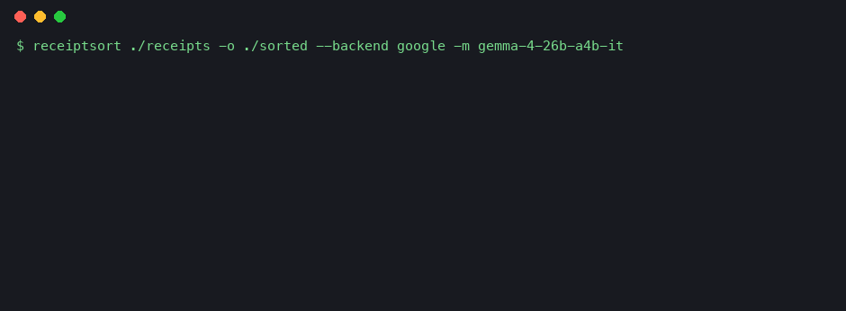
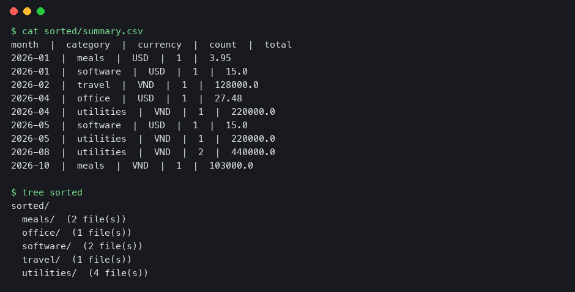

# ReceiptSort

Local-first receipt & invoice sorter for freelancers. A vision model running on **your own laptop** (via [Ollama](https://ollama.com)) reads each receipt, renames it `date_vendor_total`, files it by category, and exports a CSV for your accountant. **No cloud, no API key, no client data leaving your machine.**

## Demo




> The GIF is a replay of captured output from a real run (10 synthetic receipts, Gemma 4 26B via Google AI Studio), not a screen recording. Regenerate with `PYTHONPATH=. python docs/make_demo.py`.

## Why open-weight?
- **Privacy:** receipts contain client names and amounts; nothing is uploaded.
- **Cost:** zero per-receipt cost after the model download.
- **Swappable:** `--model` accepts any Ollama vision model (Qwen2.5-VL, Gemma 3, ...).

## Quick start
```bash
ollama pull gemma3:4b   # ~3GB, fits 16GB RAM (or qwen2.5vl:3b)
pip install -e .
receiptsort ./my-receipts -o ./sorted
```
Output: `sorted/<category>/<date>_<vendor>_<total>.jpg`, `sorted/receipts.csv` (one row per receipt) and `sorted/summary.csv` (totals per month x category, currencies kept separate).

Sample output from the 30 synthetic receipts (Gemma 4 26B via Google API): [`docs/demo-summary.csv`](docs/demo-summary.csv), [`docs/demo-receipts.csv`](docs/demo-receipts.csv).

## Optional: hosted Google backend (benchmarking only)
```bash
export GEMINI_API_KEY=...   # from Google AI Studio
python bench/run_bench.py --backend google --model <gemma-model-id>
```
This uploads images to Google, so use it on **synthetic data only**. Local Ollama stays the default.

## Develop
```bash
pip install -e ".[dev]" && pytest
```

## Roadmap / contribute
See open issues labelled `hacktoberfest` and `good first issue`. Ideas: PDF support, multi-currency totals, duplicate detection, simple web UI.

License: MIT
